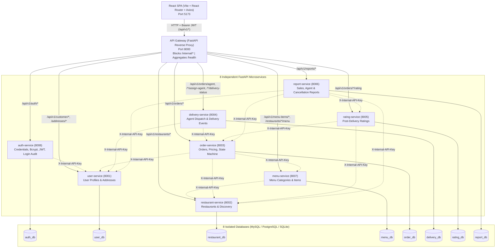
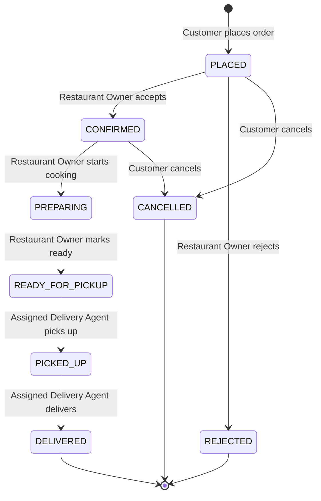

# Architecture & Database Diagrams (React — FastAPI Microservices — Database-per-Service)

This document provides the component architecture diagram and Entity-Relationship (ER) diagrams matching the Food Delivery Order Management System microservices implementation (supporting SQLite locally and MySQL 8.0 / PostgreSQL 16 via Docker Compose).

---

## 1. System Component & Communication Diagram

---

## 2. Database-per-Service ER Diagram

Cross-service references (such as `owner_id`, `customer_id`, `restaurant_id`, `menu_item_id`, `order_id`, `agent_id`) are stored as indexed integer IDs rather than cross-database foreign keys to preserve database independence and allow independent scaling/migrations via Alembic.

```mermaid
erDiagram
    AUTH_CREDENTIALS {
        int id PK
        string email UK
        string password_hash
        enum role
        boolean is_active
        datetime created_at
        datetime updated_at
    }
    LOGIN_AUDIT_LOGS {
        int id PK
        int user_id
        string email
        boolean success
        string reason
        datetime created_at
    }

    USERS {
        int id PK
        string email UK
        string full_name
        string phone
        enum role
        boolean is_active
        datetime created_at
        datetime updated_at
    }
    ADDRESSES {
        int id PK
        int user_id FK
        string line1
        string line2
        string city
        string pincode
        boolean is_default
        datetime created_at
        datetime updated_at
    }

    RESTAURANTS {
        int id PK
        int owner_id UK
        string name
        string cuisine
        string city
        string address
        time opens_at
        time closes_at
        boolean is_open
        decimal avg_rating
        datetime created_at
        datetime updated_at
    }

    MENU_CATEGORIES {
        int id PK
        int restaurant_id
        string name
        int display_order
        datetime created_at
        datetime updated_at
    }
    MENU_ITEMS {
        int id PK
        int restaurant_id
        int category_id FK
        string name
        text description
        decimal price
        boolean is_veg
        boolean is_available
        boolean is_deleted
        datetime created_at
        datetime updated_at
    }

    ORDERS {
        int id PK
        string order_no UK
        int customer_id
        int restaurant_id
        int restaurant_owner_id
        int address_id
        int agent_id
        enum status
        decimal item_total
        decimal tax_amount
        decimal delivery_fee
        decimal grand_total
        datetime placed_at
        datetime delivered_at
    }
    ORDER_ITEMS {
        int id PK
        int order_id FK
        int menu_item_id
        string item_name_snapshot
        decimal unit_price_snapshot
        int quantity
        decimal line_total
    }
    ORDER_STATUS_HISTORY {
        int id PK
        int order_id FK
        string from_status
        string to_status
        int changed_by
        datetime changed_at
        text remark
    }

    DELIVERIES {
        int id PK
        int order_id UK
        int agent_id
        int assigned_by
        string status
        datetime assigned_at
        datetime picked_up_at
        datetime delivered_at
    }
    DELIVERY_EVENTS {
        int id PK
        int delivery_id FK
        string status
        int actor_id
        text remark
        datetime occurred_at
    }

    RATINGS {
        int id PK
        int order_id UK
        int customer_id
        int restaurant_id
        int agent_id
        int restaurant_rating
        int agent_rating
        text comment
    }

    REPORT_SNAPSHOTS {
        int id PK
        string report_type
        int requested_by
        string requested_role
        string filter_context
        text payload_json
        datetime generated_at
    }

    USERS ||--o{ ADDRESSES : "owns (user_db)"
    MENU_CATEGORIES ||--o{ MENU_ITEMS : "contains (menu_db)"
    ORDERS ||--|{ ORDER_ITEMS : "snapshots (order_db)"
    ORDERS ||--|{ ORDER_STATUS_HISTORY : "audits (order_db)"
    DELIVERIES ||--|{ DELIVERY_EVENTS : "tracks (delivery_db)"
```

---

## 3. Order State Machine

